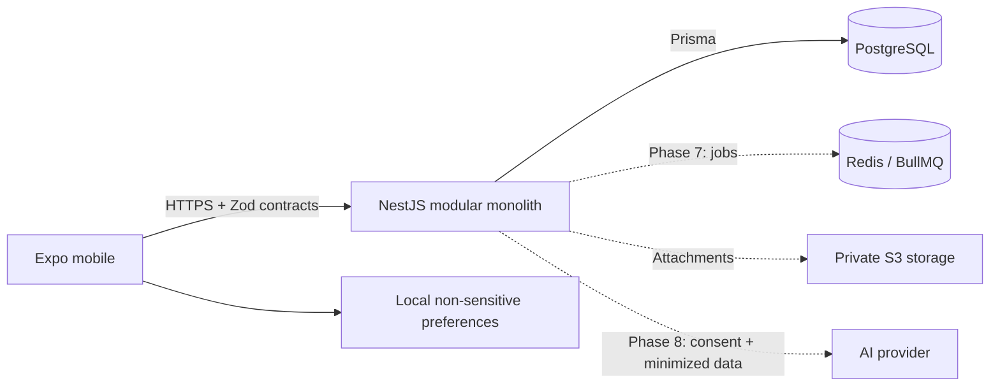

# Architecture / Arquitetura

The source connects Prisma-backed identity/accounts/categories/transactions with
personal Expo screens. Real SQL and desktop/mobile browser acceptance passed on
isolated PostgreSQL 17 (55432); local service 5432 provisioning remains pending.
/ Integração validada em PostgreSQL isolado; configuração da instância pessoal pendente.

`apps/mobile/src/personal/` loads only the authenticated user's API records, clears
screen data on session/focus changes and distinguishes query failures from empty
results. Account balances reuse the exact-cent domain function; transaction history
is loaded before deciding whether to resume first-account setup. API failures never
trigger onboarding as if the account list were empty. Transaction history
is paged until complete before computing dashboard values. Account creation records
the opening date; entry retries reuse the same idempotency key. Demo routes remain
separate and retain their fictional-data labels. Browser access grants stay in memory;
refresh is recovered through an HttpOnly SameSite cookie and atomically rotated in
the existing PostgreSQL session model. Native grants continue to use SecureStore.
Production cookies require HTTPS and configured `CORS_ORIGINS`. Local development
keeps localhost/127.0.0.1 frontend and API hostnames aligned for SameSite cookies.

```text
fintrack-pro/
  apps/mobile/       Expo, React Native, Expo Router; UI and local preferences
  apps/api/          NestJS health, identity core, Prisma schema and migration
  packages/shared/   Validated contracts, exact money and calendar primitives
  packages/config/   Shared TypeScript and lint settings
  docs/en-US/        English operating guide
  docs/pt-BR/        Guia operacional em português
  docs/adr/          Architectural decisions / decisões
  infra/            Local infrastructure and future deployment
  scripts/          Reproducible checks / verificações
```



## UI foundation / Base de interface

The Expo app shares theme tokens and components across native and web. The web
export switches to a desktop sidebar at the shared 1080 px breakpoint; smaller
viewports keep the native bottom-tab pattern. Screens constrain content width
and use responsive grids, safe areas, keyboard-aware scrolling, accessible
labels, and visible focus/press states. Theme, language, privacy, and sidebar
collapse are non-sensitive local preferences parsed through the shared Zod
schema. English and Brazilian Portuguese dictionaries share compile-time key
parity. Date and currency display uses `Intl`; monetary inputs to the currency
formatter are integer cents (`bigint`), avoiding floating-point arithmetic.

The separate fictional planning dashboard requires explicit demo entry.
`packages/shared/src/demo.ts` defines a deterministic six-month
fixture and shared calculations; `apps/mobile/src/demo/core.ts` stores it under
the dedicated `fintrack.demo.v1` key, isolated from personal preferences. Demo
payments, transaction entries and virtual-envelope events validate the entire
dataset before replacing that key. Restoring the demo never clears other local
keys. This AsyncStorage behavior is a presentation/testing sandbox, not server
financial persistence, authenticated ownership, or an offline-sync contract.

The web dashboard derives account balances, current-month figures, obligations,
budget bars and six-month posted cash flow from this fixture. Search and CSV
operate on the filtered demo transactions; CSV text is quoted and prefixed when
it could be interpreted as a spreadsheet formula. Virtual envelope movements
do not affect bank-account balances or net worth. The savings simulator is
transient and does not create records. A persistent “fictional data” label marks
these screens. Authenticated account/entry/dashboard routes instead render personal
API records and surface query errors; they do not fall back to the fixture.

Currency rendering groups bigint whole units and formats the fractional cents
without converting the financial amount to floating-point. Demo input accepts
locale decimal/grouping conventions and rejects malformed precision.

Original SVG identity sources, generated native/web icons and splash artwork
live in `apps/mobile/assets/brand/`. Expo config consumes the app icon, Android
adaptive foreground/monochrome artwork, splash and favicon. Native icon changes
require a new build and reinstall. `apps/mobile/eas.json` defines an internal
APK profile; an Expo account/project link and actual EAS build are still needed
before an installable APK exists.

## Decisions / Decisões

- Modular monolith keeps transactions in one service; future identity, ledger,
  cards, planning, reports and AI modules have explicit boundaries.
  / Monólito modular preserva atomicidade e limites entre módulos.
- npm workspaces: one lockfile, strict TypeScript, default Expo Metro support.
- Planned: TanStack Query for server state and React Hook Form for forms.
  Implemented: Zustand for local preferences/demo state and Zod contracts.
  AsyncStorage holds non-sensitive settings and isolated fictional demo data only;
  it does not store real financial records or authentication credentials.
  Tokens use SecureStore in phase 2. / Estados locais, remotos e segredos separados.
- Shared contracts are platform-independent and validated at runtime. API prefix
  is `/v1`. No server secret can enter the shared/mobile packages.
- Money uses bigint minor units internally and canonical integer strings in JSON;
  PostgreSQL BIGINT. No floating-point arithmetic for money.
- UTC event timestamps; YYYY-MM-DD calendar due dates; America/Sao_Paulo business
  timezone; explicit month-end clamping. / Instantes UTC e datas civis separadas.
- Future integrity: owner-scoped foreign keys, atomic postings, owner/operation
  idempotency keys, immutable audit events and bounded serialization retries.
  Never trust a client-supplied owner ID.
- Future card expenses recognized once; statement payments settle liabilities.
  Internal transfers are not income/expense. / Evitar dupla contagem.
- Future AI: opt-in, minimized/aggregate payloads, cost limits and explicit
  assumptions; no financial-write credentials or tools.

## Phase 2 implementation / Implementação da fase 2

Identity contracts and server-only password/token/session transitions are implemented
and unit-tested. `PasswordHasher` uses bounded asynchronous scrypt. Opaque access and
refresh credentials are separate from the persisted digest-only state. Refresh
transitions detect replay and use transactional Prisma repositories. Identity HTTP
routes are mounted; there is no in-memory persistence substitute.

The Prisma schema now also defines owner-scoped accounts, categories and ledger
transactions. Amounts are `BIGINT` minor units, transfers use source/destination
account references, and an owner-scoped idempotency key prevents duplicate entries.
Composite foreign keys enforce that referenced accounts/categories belong to the
same user. Four migrations and nine SQL integration tests passed on PostgreSQL 17.
Authenticated account/entry routes and shared mobile/web forms passed the real
browser acceptance scenario in desktop and mobile viewports. Native-device session
behavior and broader ledger editing/payment workflows still need validation/work.

Contratos e funções de senha, tokens e transições de sessão estão implementados e
testados. Repositórios transacionais Prisma e rotas reais de identidade/finanças
foram validados no PostgreSQL isolado, inclusive reload, reinício da API e novo login.
Isso não recupera automaticamente as credenciais da instância pessoal em 5432.

## Boundaries / Limites

Navigation and display preferences are real local behavior. Empty screens must
not present zeros as verified bank balances. Health means process liveness only,
not database readiness. The accepted scope is registration/login, account creation,
posted entries and dashboard persistence; complete editing, billing and planning
lifecycles are still pending. Web uses the same React Native UI.

Navegação e preferências funcionam localmente. Telas vazias não inventam saldos.
Saúde da API não significa prontidão do banco. O fluxo básico foi validado com banco
real isolado; configuração pessoal, ciclo financeiro completo e release continuam pendentes.

See [roadmap](ROADMAP.md), [database](DATABASE.md), [security](SECURITY.md) and
[ADR](docs/adr/0001-foundation.md).
