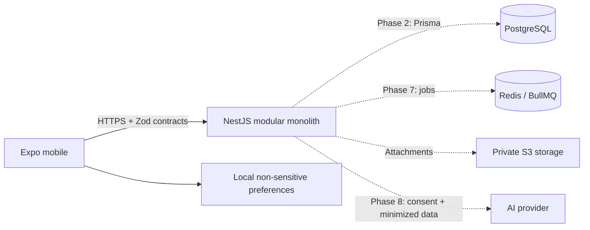

# Architecture / Arquitetura

Phase 1 foundation and phase 2 identity core. Database-backed services remain pending.
/ Fundação da fase 1 e núcleo da fase 2; serviços persistentes continuam pendentes.

```text
fintrack-pro/
  apps/mobile/       Expo, React Native, Expo Router; UI and local preferences
  apps/api/          NestJS health, identity core, Prisma schema and migration
  packages/shared/   Validated contracts, exact money and calendar primitives
  packages/config/   Shared TypeScript and lint settings
  docs/en-US/        English operating guide
  docs/pt-BR/        Guia operacional em português
  docs/adr/          Architectural decisions / decisões
  infra/            Local infrastructure and future deployment
  scripts/          Reproducible checks / verificações
```



## UI foundation / Base de interface

The Expo app shares theme tokens and components across native and web. The web
export switches to a desktop sidebar at the shared 1080 px breakpoint; smaller
viewports keep the native bottom-tab pattern. Screens constrain content width
and use responsive grids, safe areas, keyboard-aware scrolling, accessible
labels, and visible focus/press states. Theme, language, privacy, and sidebar
collapse are non-sensitive local preferences parsed through the shared Zod
schema. English and Brazilian Portuguese dictionaries share compile-time key
parity. Date and currency display uses `Intl`; monetary inputs to the currency
formatter are integer cents (`bigint`), avoiding floating-point arithmetic.

No analytics, transaction list, balances, or operational financial controls are
rendered without a real persisted data source. The current empty states describe
that limitation directly; implementing a UI does not imply backend integration.

## Decisions / Decisões

- Modular monolith keeps transactions in one service; future identity, ledger,
  cards, planning, reports and AI modules have explicit boundaries.
  / Monólito modular preserva atomicidade e limites entre módulos.
- npm workspaces: one lockfile, strict TypeScript, default Expo Metro support.
- Planned: TanStack Query for server state and React Hook Form for forms.
  Implemented: Zustand for local preferences and Zod contracts.
  AsyncStorage only holds non-sensitive settings.
  Tokens use SecureStore in phase 2. / Estados locais, remotos e segredos separados.
- Shared contracts are platform-independent and validated at runtime. API prefix
  is `/v1`. No server secret can enter the shared/mobile packages.
- Money uses bigint minor units internally and canonical integer strings in JSON;
  planned PostgreSQL BIGINT. No floating-point arithmetic for money.
- UTC event timestamps; YYYY-MM-DD calendar due dates; America/Sao_Paulo business
  timezone; explicit month-end clamping. / Instantes UTC e datas civis separadas.
- Future integrity: owner-scoped foreign keys, atomic postings, owner/operation
  idempotency keys, immutable audit events and bounded serialization retries.
  Never trust a client-supplied owner ID.
- Future card expenses recognized once; statement payments settle liabilities.
  Internal transfers are not income/expense. / Evitar dupla contagem.
- Future AI: opt-in, minimized/aggregate payloads, cost limits and explicit
  assumptions; no financial-write credentials or tools.

## Phase 2 implementation / Implementação da fase 2

Identity contracts and server-only password/token/session transitions are implemented
and unit-tested. `PasswordHasher` uses bounded asynchronous scrypt. Opaque access and
refresh credentials are separate from the persisted digest-only state. Refresh
transitions detect replay and require atomic repository integration before use.
No identity HTTP routes are mounted; there is no in-memory persistence substitute.

The Prisma schema now also defines owner-scoped accounts, categories and ledger
transactions. Amounts are `BIGINT` minor units, transfers use source/destination
account references, and an owner-scoped idempotency key prevents duplicate entries.
Composite foreign keys enforce that referenced accounts/categories belong to the
same user. Prisma schema validation and client generation pass locally; both SQL
migrations still need execution against PostgreSQL. There are no financial routes,
repositories, authenticated owner context or mobile ledger flows yet.

Contratos e funções de senha, tokens e transições de sessão estão implementados e
testados. A integração exige repositório transacional PostgreSQL. Schema Prisma,
migração e testes reais foram escritos, mas aguardam execução e validação em PostgreSQL. Não há
endpoints de identidade nem armazenamento em memória apresentado como integração.

## Boundaries / Limites

Navigation and display preferences are real local behavior. Empty screens must
not present zeros as verified bank balances. Health means process liveness only,
not database readiness. No financial CRUD, authentication or database connection
is claimed. Web is a development preview of the same React Native UI.

Navegação e preferências funcionam localmente. Telas vazias não inventam saldos.
Saúde da API não significa prontidão do banco. Banco, autenticação e operações
financeiras serão implementados e testados nas próximas fases.

See [roadmap](ROADMAP.md), [database](DATABASE.md), [security](SECURITY.md) and
[ADR](docs/adr/0001-foundation.md).
