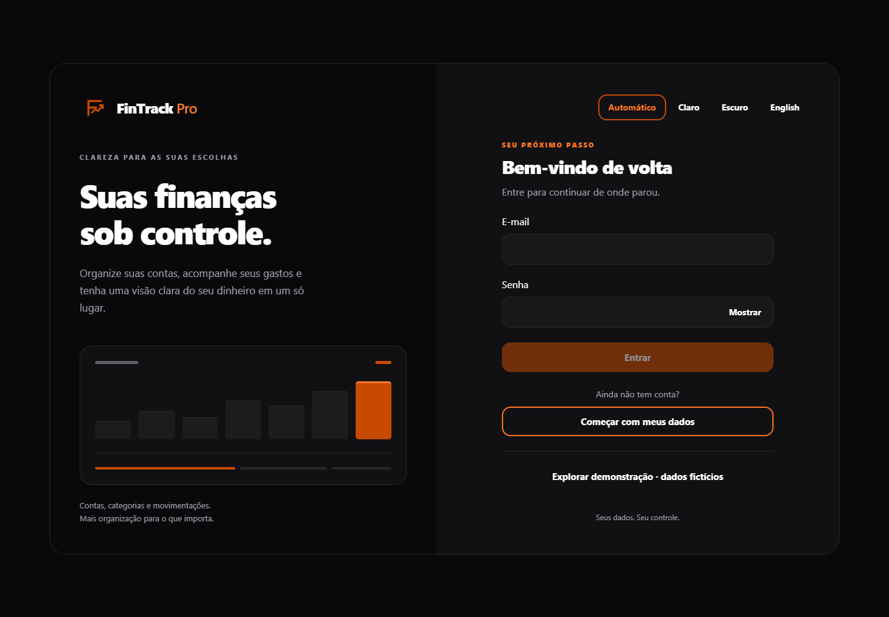
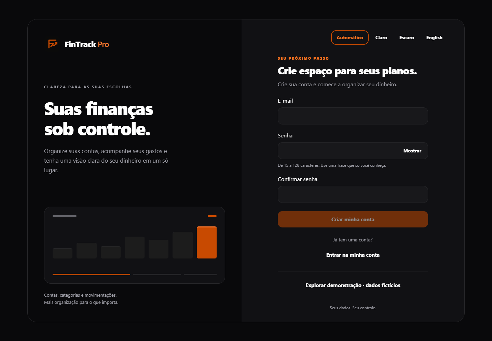
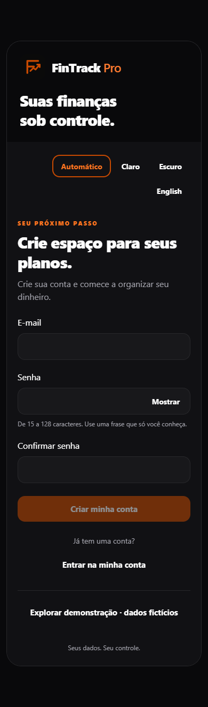
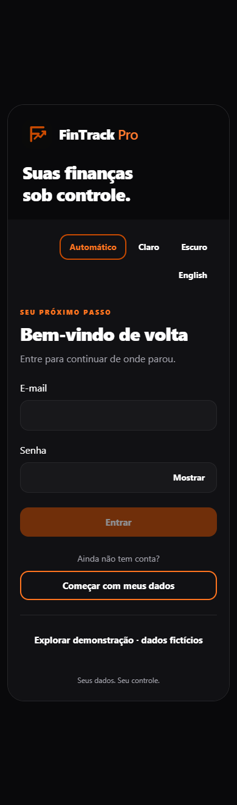

# FinTrack Pro

## Latest local changes

The personal history now supports transaction editing, confirmed logical removal, and filters by type, account and category. Mutations retain audit snapshots and reject stale revisions. The dashboard includes previous-month comparison and category spending. Apply the five versioned migrations before running this source. Isolated SQL acceptance and GitHub publication remain pending. See [release preparation](docs/release-readiness.md).

**Personal finance management with real authentication, accounts, transactions and a clear view of your money.**

[Português (Brasil)](README.pt-BR.md) · [Local setup](docs/local-development.md) · [Architecture](ARCHITECTURE.md) · [Validation](docs/auth-redesign-validation.md)



## Overview

FinTrack Pro brings account balances, income, expenses and transaction history into one responsive application. The authenticated experience stores real, owner-scoped records in PostgreSQL. A separate, clearly labelled fictional demo lets visitors explore the interface without creating an account.

The login and registration screens share the app's orange identity, dark surfaces and typography. Desktop uses a split presentation/form layout; mobile uses a scrolling vertical layout. Light, dark and system themes and Portuguese/English preferences remain available.

## Implemented features

| Area           | Behavior                                                                                                                                  |
| -------------- | ----------------------------------------------------------------------------------------------------------------------------------------- |
| Authentication | Email/password registration, confirmation, login, validation and specific HTTP/network feedback                                           |
| Sessions       | HttpOnly web refresh cookie, reload restoration, access renewal, logout and protected routes; native grants use SecureStore               |
| Accounts       | Create accounts with an exact opening balance/date; rename and archive while preserving history                                           |
| Categories     | Owner-scoped income and expense categories                                                                                                |
| Transactions   | Posted income/expenses, internal transfer contracts, paginated history and per-user idempotency keys                                      |
| Dashboard      | Account totals, income, expenses and balances calculated from persisted records using exact integer cents                                 |
| Budgets        | Monthly limits by expense category, calculated from posted expenses and stored per user in PostgreSQL                                     |
| Goals          | Personal targets and informational contribution records, persisted per user without changing account balances                             |
| Reports        | Six or twelve month income, expense and category reports from posted transactions; web CSV export in exact decimal cents                  |
| User isolation | Session-derived identity and account/category ownership checks on financial operations                                                    |
| Interface      | Responsive navigation, accessible labels/focus, password visibility, loading states, reduced-motion form transition and local preferences |

Real browser acceptance covers registration → account → categories → income/expense → reload → refresh → logout/login → user isolation. The reference scenario produces **R$ 1,300.00** from a R$ 1,000 opening balance, R$ 500 income and R$ 200 expense. These are synthetic test records, not preloaded personal data.

Planning, bills, envelopes and simulations are available in the **fictional demo**. They are not connected to the authenticated PostgreSQL workflow. The personal report CSV export is available on web. This application does not connect to a bank or move external money.

## Screenshots

Captured from the running application with empty fields and fresh browser contexts. Mobile images use a 390 px-wide viewport tall enough to show the full form; narrow and short screens are separately tested for scrolling and overflow.

| Registration — desktop                                              | Registration — mobile                                             | Login — mobile                                          |
| ------------------------------------------------------------------- | ----------------------------------------------------------------- | ------------------------------------------------------- |
|  |  |  |

The existing [desktop demo](docs/screenshots/demo-dashboard-desktop.png) and [mobile demo](docs/screenshots/demo-dashboard-mobile.png) screenshots contain explicitly fictional financial data. Regenerate authentication images from a running local app with `node scripts/capture-auth-screenshots.mjs`.

## Stack and architecture

- **App:** Expo, React Native, React Native Web, Expo Router, React and TypeScript.
- **State/storage:** Zustand, AsyncStorage for non-sensitive preferences/demo, Expo SecureStore for native grants.
- **API:** NestJS with shared Zod runtime contracts, Prisma 7 and the PostgreSQL driver adapter.
- **Database:** PostgreSQL 17 for this local development installation; a separate PostgreSQL 18 test service is configured.
- **Quality:** npm Workspaces, ESLint, Prettier, Node tests, Playwright and GitHub Actions.
- **Design:** shared React Native components and tokens; no additional styling library is required.

```text
apps/mobile/          Expo Router app, authentication, personal finance and demo
apps/api/src/         NestJS identity, accounts, categories and transactions
apps/api/prisma/      Prisma schema and four versioned SQL migrations
packages/shared/      Runtime contracts, exact money and calendar/domain rules
packages/config/      TypeScript and lint configuration
scripts/              Environment, database, development and validation helpers
tests/                Unit, domain and HTTP regression tests
tests/integration/    Dedicated PostgreSQL integration tests
e2e/                  UI/demo browser tests; real database cases under real/
infra/                Optional local PostgreSQL Compose configuration
docs/                 Architecture decisions, setup, screenshots and evidence
```

The request path is **Expo → shared HTTP client → NestJS → Prisma → PostgreSQL**. Bearer grants identify the current user; client-supplied owner IDs are not trusted. Web refresh credentials stay in a host-scoped HttpOnly cookie. See [architecture](ARCHITECTURE.md) and [security](SECURITY.md) for boundaries.

## Installation and local execution

Requires Node.js **>=24.13.0 <25**, npm, PostgreSQL and registry access for the first install. Use `npm.cmd`/`npx.cmd` in Windows PowerShell if script policy blocks `.ps1` launchers. Microsoft Edge is used by browser tests.

```powershell
Set-Location C:\Projetos\fintrack-pro
npm.cmd ci
# Preserve an existing local environment:
if (!(Test-Path .env)) { Copy-Item .env.example .env }
```

Edit the ignored root `.env` locally. Configure distinct application credentials for `DATABASE_URL` and `TEST_DATABASE_URL`; URL-encode password characters. Never put a secret in an `EXPO_PUBLIC_` variable.

| Setting                    | Purpose                                                                             |
| -------------------------- | ----------------------------------------------------------------------------------- |
| `DATABASE_URL`             | Main local PostgreSQL 17 application database, normally 127.0.0.1:5432/fintrack     |
| `TEST_DATABASE_URL`        | Separate loopback database ending in `_test`, normally 127.0.0.1:5433/fintrack_test |
| `EXPO_PUBLIC_API_URL`      | Public API base including `/v1`, e.g. http://127.0.0.1:3000/v1                      |
| `HOST`, `PORT`             | API bind address and port; default 127.0.0.1:3000                                   |
| `NODE_ENV`, `CORS_ORIGINS` | Environment and explicit browser-origin allowlist                                   |

For an existing installation, inspect migration status first. `db:migrate` deploys pending additive migrations without reset. The local main database used for this validation has all eight migrations applied; verify your own database before starting the API.

```powershell
npm.cmd run build
npm.cmd run db:status
npm.cmd run db:migrate
npm.cmd run doctor
npm.cmd run api
# Another terminal:
npm.cmd run web
# Or use an explicit Expo port:
npm.cmd run web -- --port 8083
# Expo for a compatible device/simulator:
npm.cmd run mobile
```

Monthly budgets and goals require the new additive migrations. Before migrating a database with real records, make a backup and inspect `apps/api/prisma/migrations/20261103210000_monthly_budgets`, `20261103220000_savings_goals` and `20261103230000_goal_contribution_idempotency`. Budget spending is derived from posted expenses; goal contributions are informational and do not reserve money in accounts.

Open the URL Expo prints, normally **http://localhost:8081/login**. `npm.cmd run dev` is the combined launcher on 8081. The API start command loads the root `.env`; Expo launchers forward its public API URL with shell overrides taking precedence.

Check database readiness, not just process health:

```powershell
Invoke-RestMethod http://127.0.0.1:3000/v1/health/ready
# service: fintrack-api; status: ok; scope: database
```

Development CORS trusts exact `localhost`, `127.0.0.1` and `[::1]` origins on dynamic ports; unrelated external origins are denied. Production requires an explicit `CORS_ORIGINS` list and a deployed HTTPS API. Credentials are never combined with wildcard allow-origin. Keep web/API within the same site for the Strict refresh-cookie policy.

Web loopback resolution keeps the browser's hostname for cookies. Android emulator uses `10.0.2.2`; Expo Go can use the computer's private LAN host. A physical device needs a reachable API, appropriate `HOST` binding and firewall access. An Expo tunnel does not expose the separate Nest API. See [complete networking instructions](docs/local-development.md).

Use `netstat -ano -p tcp` and `Get-Process -Id <PID>` to identify port conflicts. Preserve unknown processes and choose alternative ports. Database provisioning/audit instructions are in [DATABASE.md](DATABASE.md) and the [credential procedure](docs/postgresql-local-credentials.md); an existing working database does not require administrative recovery.

## Tests

```powershell
npm.cmd run build
npm.cmd run lint
npm.cmd run typecheck
npm.cmd test
npm.cmd run format:check
npm.cmd run doctor
npm.cmd run db:status
npm.cmd run test:integration
```

UI/demo browser tests require a fresh export. They intercept API requests so they never register personal users:

```powershell
$env:EXPO_PUBLIC_API_URL='https://api.example.test/v1'
npm.cmd run bundle
Remove-Item Env:EXPO_PUBLIC_API_URL
npm.cmd run test:e2e
```

`bundle` exports web, Android and iOS. `test:e2e` serves the export on 4173 and tests desktop/mobile browser viewports. `test:e2e:real` requires a working isolated `_test` database and runs SQL/browser persistence acceptance. `test:e2e:isolated -- --version 18` attempts a separate fresh local cluster; it never uses the main database.

To recheck the **main local database** with clearly identified synthetic records retained:

```powershell
node scripts/validate-local-auth.mjs --api http://127.0.0.1:3000/v1 --web http://localhost:8081 --keep-synthetic-data
```

This explicitly writes `communication-*@example.test` users and financial records, tests 14 checkpoints and never deletes existing records. Unit/UI fixture tests and the real PostgreSQL smoke are reported separately.

## Security and current status

Passwords use scrypt with unique salts. Persisted opaque access/refresh credentials are hashed; refresh rotates and detects replay. Financial queries enforce ownership. Browser refresh cookies are HttpOnly and SameSite=Strict, with Secure in production. Authentication routes enforce Origin validation and a single-process rate limiter. Application database failures use safe responses. Secrets, `.env`, generated outputs, installed dependencies and local runtime data are ignored by Git.

Application Prisma connections use UTC to preserve timestamp instants; existing historical rows were not bulk-rewritten. This does not change the user's display timezone.

The main PostgreSQL 17 workflow was revalidated after the redesign. The configured test service on 5433 still rejects credentials (`28P01`/Prisma `P1000`), and sandbox token restrictions block the alternative isolated cluster. Native exports and browser viewports do not establish physical-device execution. Password recovery/email lifecycle, bank integration, production-wide rate limiting and production deployment remain open. No nonfunctional recovery link is displayed.

[Latest redesign validation](docs/auth-redesign-validation.md) records exact commands and results. [Communication acceptance](docs/validation-2026-11-02.md) is historical evidence. [COMMITS.md](COMMITS.md) records reviewable units: this session's Git writes and GitHub HTTPS are blocked, so pending source changes must not be described as published. GitHub Actions is configured in [.github/workflows/ci.yml](.github/workflows/ci.yml); no remote run is claimed here.

## Author

**VRAS CODE** · [GitHub](https://github.com/vrascode) · [Portfolio](https://vrascode.dev)

# Cloud deployment (prepared)

The existing Vercel frontend needs a newly built public HTTPS API URL ending in
`/v1`. See [Neon, Render, Vercel and Android deployment](docs/PRODUCTION_DEPLOYMENT.md).
No cloud API, database, or signed APK is claimed by the local configuration.
