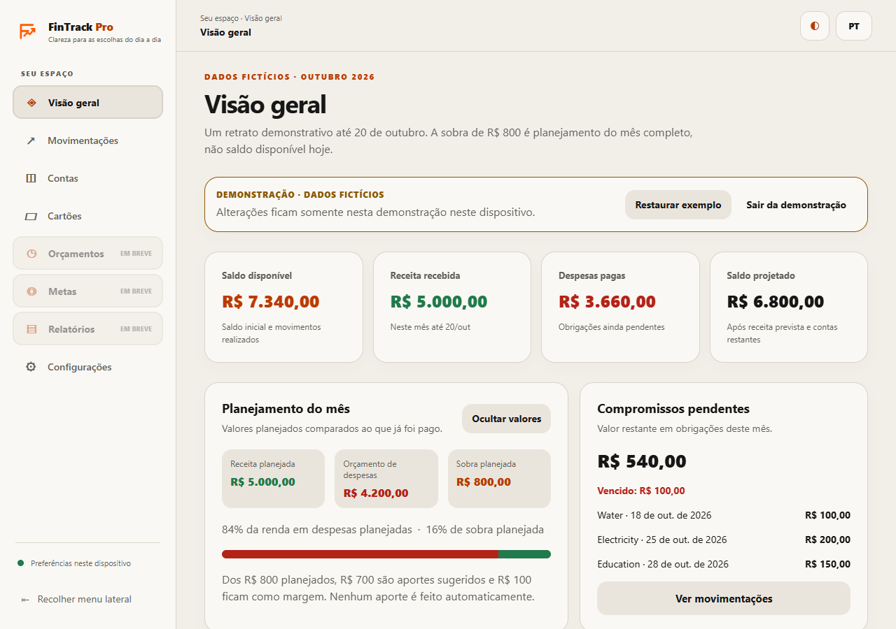

# FinTrack Pro

**A personal finance application built with Expo, React Native, TypeScript and NestJS.**

[Português (Brasil)](README.pt-BR.md) · [Roadmap](ROADMAP.md) · [Validation log](PORTFOLIO_PROGRESS.md)

FinTrack Pro is being developed for mobile devices with shared contracts, exact
money calculations and explicit security boundaries. A clearly labelled,
isolated fictional demo exercises planning flows on web and mobile. The source now
connects authenticated accounts, posted income/expenses, categories and a personal
dashboard to the Prisma API. Real PostgreSQL 17 acceptance passed in an isolated
test cluster: registration, login, accounts, income/expenses and persistence.
The personal development instance on 5432 still requires local admin-password
recovery and provisioning; this is not yet a ready-to-use deployment.

## What works today

| Area                 | Implemented behavior                                                                                                                        |
| -------------------- | ------------------------------------------------------------------------------------------------------------------------------------------- |
| App                  | Responsive desktop/mobile shell; overview, demo accounts/activity/bills/envelopes/planning and preferences                                  |
| Preferences          | Light/dark/system theme, privacy settings, persistence, corruption recovery and storage-error handling                                      |
| Domain               | Exact integer money, financial planning calculations, validated calendar dates, CSV formula protection and shared Zod contracts             |
| API                  | NestJS registration/login, readiness and owner-scoped accounts/categories/transactions; loopback by default                                 |
| Identity core        | Password hashing/verification, opaque tokens, expiry, rotation/replay and device-revocation transitions, tested independently of a database |
| Database preparation | Four Prisma migrations, nine real SQL tests and two financial browser cases passed on isolated PostgreSQL 17                                |

The API includes registration/login, owner authorization, refresh-cookie session
recovery and account/category/transaction endpoints. Unit tests do not establish
PostgreSQL persistence. See [database setup and remaining work](DATABASE.md).

### Local personal-data workflow

Run `node scripts/setup-local-postgres.mjs --development` in your terminal to
provision missing project roles/databases using `DATABASE_URL` (5432 locally).
Admin passwords are hidden and never saved. Explicit `--reconcile-password` can
align the dedicated `fintrack` role with its ignored `.env` password; privileged
or shared roles are refused. Test provisioning is separate:
`node scripts/setup-local-postgres.mjs --test` uses only `TEST_DATABASE_URL` (5433).
Add `--inspect` to see safe target metadata without connecting. For a lost admin
password, use the [local recovery procedure](DATABASE.md#recover-local-postgresql-17--recuperar-postgresql-17-local).
Run `npm.cmd run db:migrate`, then `npm.cmd run api` and `npm.cmd run web` in separate
terminals. Open `http://localhost:8081/login`; registration leads to the first account
form. Enter its opening balance/reference date, then use **New income or expense**
on the personal dashboard. No sample records are inserted into personal accounts.
API readiness is `http://127.0.0.1:3000/v1/health/ready` and must return 200.

`npm.cmd run test:e2e:real` requires the isolated `_test` database. It applies
versioned migrations and runs browser registration → 1,000 BRL opening balance →
500 BRL income → 200 BRL expense → 1,300 BRL balance, including reload, API restart,
logout/login, ownership and transaction replay checks. `npm.cmd run test:e2e:isolated`
ran that suite successfully using a fresh PostgreSQL 17 cluster on 55432: nine SQL
tests and both desktop/mobile browser cases passed. It leaves `.env` and services
5432/5433 unchanged; those configured instances still need their own provisioning.
Local use requires the database and API processes to stay running. A physical phone
also needs a reachable API; no independent phone deployment is claimed.

## Interface and localization

The mobile app and web export share a responsive UI foundation with light, dark,
and system themes. Non-sensitive theme, language, privacy, and desktop sidebar
preferences are stored locally. The interface supports Brazilian Portuguese and
English, with locale-aware date and exact-cent currency formatters. The web
layout adds a collapsible desktop sidebar; mobile keeps bottom-tab navigation.
Selecting **Explore demo** on the dashboard opens a six-month fictional dataset
persisted under a separate local key. The demo supports transaction entry,
filtered CSV export, partial bill payments, virtual envelope contributions and
withdrawals, and an unsaved savings simulator. A visible fictional-data badge
marks these routes. Restoring or editing demo data never touches personal
records or a bank account. These screens are not real-user finance services.
See [architecture](ARCHITECTURE.md) for UI and persistence boundaries.

| Desktop demo                                                                                        | Mobile demo                                                                                       |
| --------------------------------------------------------------------------------------------------- | ------------------------------------------------------------------------------------------------- |
|  |  |

### Brand assets and Android preview

Original SVG source artwork and generated icons are in `apps/mobile/assets/brand/`.
The Expo config uses the app icon, Android adaptive foreground/monochrome icon,
splash artwork and web favicon. Native icon changes require a new native build
and reinstall; Expo fast refresh cannot replace the installed icon.

An internal APK profile is configured in `apps/mobile/eas.json`. To build after
linking the project to an authenticated Expo account, run from `apps/mobile`:

```sh
npx eas-cli build --platform android --profile preview
```

No APK is checked into the repository or claimed as released by this change.

## Quick start

Requirements: Node.js 24 LTS (`>=24.13.0 <25`), npm and registry access for the first
install. Local checks used Node 24.20.0 and npm 11.19.0. Use `npm.cmd` / `npx.cmd`
in Windows PowerShell if script policy blocks `npm.ps1`.

```sh
npm ci
npm run build
npm run api
# In a second terminal
npm run web
# Or start Expo for a compatible device/simulator
npm run mobile
```

Open the URL printed by Expo. In **Ajustes**, choose **Escuro**, enable
**Ocultar valores por padrão**, then reload: both settings persist on that device.
Storage failures are reported without claiming the change was saved.

`GET http://127.0.0.1:3000/v1/health` returns:

```json
{ "service": "fintrack-api", "status": "ok", "scope": "process" }
```

Set `HOST` and `PORT` in the shell; the API does not automatically load `.env`.
Database scripts load the root `.env` separately. [.env.example](.env.example)
contains configuration names without credentials.

## Development and validation

```sh
npm run check          # Lint, build/typecheck, local tests and formatting
npm run bundle         # Android, iOS and web exports
npm run test:e2e       # Headless Edge: desktop and mobile browser viewports
```

GitHub Actions runs these checks, native web/mobile exports and both browser
viewports on pushes and pull requests to `main`. See the [CI workflow](.github/workflows/ci.yml).

E2E requires an up-to-date bundle and installed Microsoft Edge, starts its own
server on port 4173 and closes it after the run. Manual preview:
`node scripts/serve.mjs`. Native exports and browser viewports do not establish
native device, biometric or release-signing compatibility.

Follow [DATABASE.md](DATABASE.md) to configure separate development/test databases and run:

```sh
npm run db:validate
npm run db:generate
npm run db:migrate
npm run test:integration
```

Integration is a separate required gate: it fails when prerequisites are missing,
never falls back to the development database and does not count as a passing unit
test. Exact results and blockers are in [the progress log](PORTFOLIO_PROGRESS.md).

## Repository

```text
apps/mobile/       Expo Router UI, design system and local preferences
apps/api/          NestJS health API, identity core, Prisma schema/migration
packages/shared/   Runtime contracts, money and calendar primitives
packages/config/   Strict TypeScript and lint defaults
infra/             Local PostgreSQL services
tests/             Domain, security, persistence and HTTP tests
tests/integration/ PostgreSQL/Prisma integration suite
e2e/               Browser interaction tests
```

Read the [architecture](ARCHITECTURE.md), [security review](SECURITY.md),
[development guide](docs/en-US/DEVELOPMENT.md), [decisions](docs/adr/0001-foundation.md)
and [research](docs/RESEARCH.md).

## Project status

Phase 2 is **in progress, not accepted**. Prisma schema validation and client
generation pass locally. Identity and ledger migrations still need a real PostgreSQL
run; transactional repositories, authenticated HTTP flows, financial CRUD, account
balance queries and mobile workflows are not implemented. Email lifecycle, SecureStore,
biometrics and later billing/reporting features also remain. This is not a
production-ready financial service.

Existing source changes were committed by feature and published to `origin/main`
on 2026-10-27 after the Git permission and connectivity blockers were resolved
through approved operations. See the [publication record](PORTFOLIO_PROGRESS.md).
The latest `npm audit fix` removed the `node-forge` advisory but reported eight
remaining Expo-tooling findings (three high, five low); the remaining automatic
fix requires a breaking Expo downgrade and was not applied. Real database
validation also remains pending. Secrets, local data, caches and generated
outputs stay out of Git.
