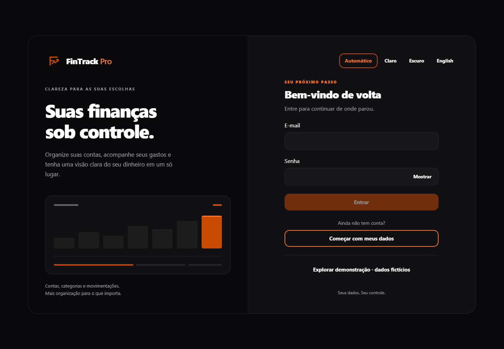
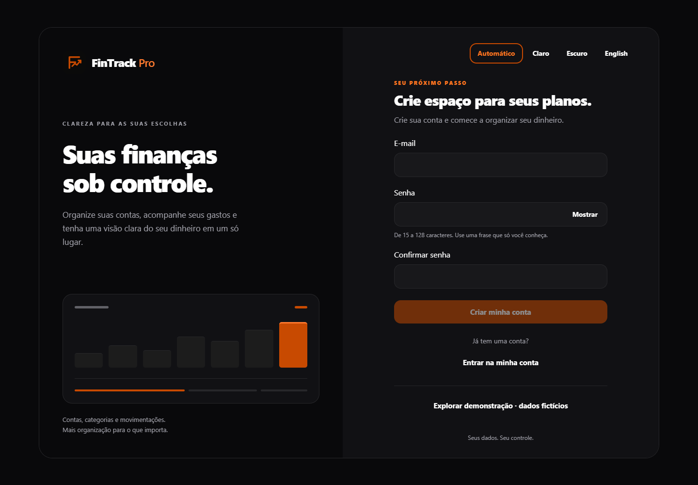
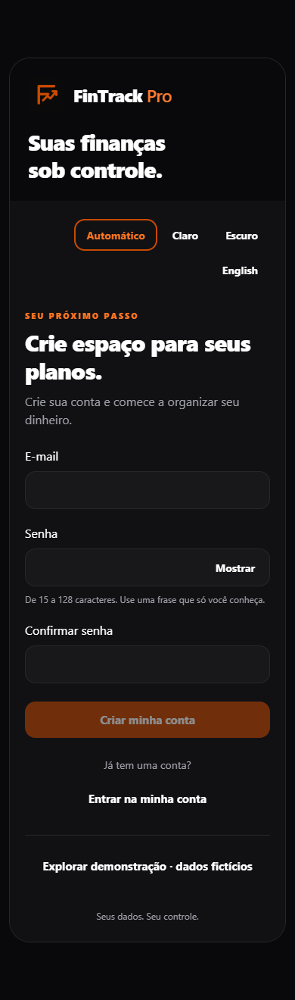
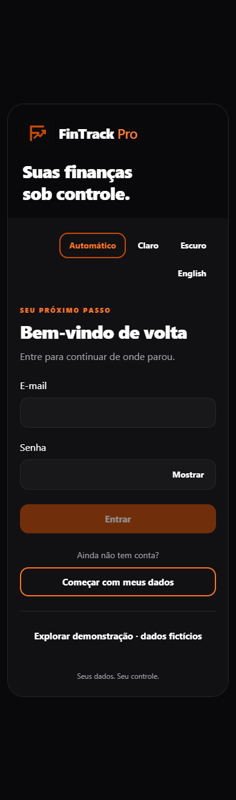

# FinTrack Pro

**Aplicação de gestão financeira pessoal com autenticação real, contas, transações e uma visão clara do seu dinheiro.**

[English](README.md) · [Execução local](docs/local-development.md) · [Arquitetura](ARCHITECTURE.md) · [Validação](docs/auth-redesign-validation.md)



## Visão geral

O FinTrack Pro reúne saldos de contas, receitas, despesas e histórico em uma aplicação responsiva. O fluxo autenticado armazena registros reais no PostgreSQL, separados por usuário. Uma demonstração fictícia, isolada e identificada permite explorar a interface sem criar uma conta.

Login e cadastro compartilham a identidade laranja, as superfícies escuras e a tipografia do aplicativo. O desktop apresenta marca e formulário em duas áreas; no celular, o layout é vertical com rolagem. As preferências de tema claro, escuro e automático e os idiomas português/inglês foram preservados.

## Funcionalidades implementadas

| Área         | Comportamento                                                                                                                               |
| ------------ | ------------------------------------------------------------------------------------------------------------------------------------------- |
| Autenticação | Cadastro com e-mail/senha, confirmação de senha, login, validação e mensagens específicas para erros HTTP e de conexão                      |
| Sessão       | Cookie web HttpOnly, recuperação após recarregar, renovação de acesso, logout e rotas protegidas; credenciais nativas no SecureStore        |
| Contas       | Criação com saldo/data inicial exatos; alteração de nome e arquivamento preservando o histórico                                             |
| Categorias   | Categorias de receitas e despesas pertencentes ao usuário                                                                                   |
| Transações   | Receitas/despesas realizadas, contratos de transferência interna, histórico paginado e chaves de idempotência por usuário                   |
| Dashboard    | Totais de contas, entradas, saídas e saldos calculados sobre registros persistidos, com centavos inteiros exatos                            |
| Isolamento   | Identidade derivada da sessão e verificação de propriedade das contas/categorias nas operações                                              |
| Interface    | Navegação responsiva, labels e foco acessíveis, visibilidade de senha, carregamento, transição com movimento reduzido e preferências locais |

O aceite real pelo navegador cobre cadastro → conta → categorias → receita/despesa → recarregamento → refresh → logout/login → isolamento entre usuários. O cenário de referência resulta em **R$ 1.300,00**: saldo inicial de R$ 1.000, receita de R$ 500 e despesa de R$ 200. São registros sintéticos de teste; nenhuma conta pessoal recebe esses exemplos automaticamente.

Planejamento, contas a pagar, caixinhas, exportação CSV e simulador estão disponíveis na **demonstração fictícia**. Nem todos esses recursos estão conectados ao fluxo autenticado do PostgreSQL. A aplicação não se conecta a bancos nem movimenta dinheiro externo.

## Imagens

Capturas do aplicativo em execução, com campos vazios e contextos novos de navegador. As imagens mobile usam viewport de 390 px de largura e altura suficiente para mostrar o formulário inteiro. Telas estreitas e baixas também são testadas quanto a rolagem e transbordamento.

| Cadastro — desktop                                                 | Cadastro — mobile                                                 | Login — mobile                                              |
| ------------------------------------------------------------------ | ----------------------------------------------------------------- | ----------------------------------------------------------- |
|  |  |  |

As capturas existentes da [demonstração desktop](docs/screenshots/demo-dashboard-desktop.png) e [mobile](docs/screenshots/demo-dashboard-mobile.png) contêm dados financeiros explicitamente fictícios. Para recapturar a autenticação com o app local em execução, use `node scripts/capture-auth-screenshots.mjs`.

## Tecnologias e arquitetura

- **Aplicativo:** Expo, React Native, React Native Web, Expo Router, React e TypeScript.
- **Estado e armazenamento:** Zustand, AsyncStorage para preferências/demonstração e Expo SecureStore para credenciais nativas.
- **API:** NestJS, contratos Zod compartilhados, Prisma 7 e adaptador PostgreSQL.
- **Banco:** PostgreSQL 17 nesta instalação de desenvolvimento; serviço PostgreSQL 18 separado para testes.
- **Qualidade:** npm Workspaces, ESLint, Prettier, testes Node, Playwright e GitHub Actions.
- **Design:** componentes e tokens React Native compartilhados, sem biblioteca adicional de estilos.

```text
apps/mobile/          App Expo Router, autenticação, finanças pessoais e demonstração
apps/api/src/         NestJS: identidade, contas, categorias e transações
apps/api/prisma/      Schema Prisma e quatro migrações SQL versionadas
packages/shared/      Contratos, dinheiro exato e regras de calendário/domínio
packages/config/      Configuração TypeScript e lint
scripts/              Ambiente, banco, desenvolvimento e validação
tests/                Testes unitários, de domínio e HTTP
tests/integration/    Integração com PostgreSQL dedicado
e2e/                  Testes de interface/demonstração; banco real em real/
infra/                Configuração Compose PostgreSQL opcional
docs/                 Decisões, execução, screenshots e evidências
```

O caminho da requisição é **Expo → cliente HTTP compartilhado → NestJS → Prisma → PostgreSQL**. A sessão identifica o usuário; IDs de proprietário enviados pelo cliente não são considerados confiáveis. No navegador, o refresh permanece em cookie HttpOnly restrito ao host. Consulte [arquitetura](ARCHITECTURE.md) e [segurança](SECURITY.md).

## Instalação e execução local

Requisitos: Node.js **>=24.13.0 <25**, npm, PostgreSQL e acesso ao registro para instalar dependências. No Windows PowerShell, use `npm.cmd`/`npx.cmd` se a política bloquear os launchers `.ps1`. Os testes de navegador usam Microsoft Edge.

```powershell
Set-Location C:\Projetos\fintrack-pro
npm.cmd ci
# Preserve um ambiente local já configurado:
if (!(Test-Path .env)) { Copy-Item .env.example .env }
```

Edite o `.env` ignorado da raiz no editor local. Configure credenciais de aplicação distintas em `DATABASE_URL` e `TEST_DATABASE_URL`; codifique caracteres especiais da senha na URL. Nunca coloque segredos em variáveis `EXPO_PUBLIC_`.

| Configuração               | Finalidade                                                                                                       |
| -------------------------- | ---------------------------------------------------------------------------------------------------------------- |
| `DATABASE_URL`             | Banco principal PostgreSQL 17, normalmente 127.0.0.1:5432/fintrack                                               |
| `TEST_DATABASE_URL`        | Banco de testes separado, em loopback e com nome terminando em `_test`, normalmente 127.0.0.1:5433/fintrack_test |
| `EXPO_PUBLIC_API_URL`      | URL pública da API incluindo `/v1`, por exemplo http://127.0.0.1:3000/v1                                         |
| `HOST`, `PORT`             | Interface e porta da API; padrão 127.0.0.1:3000                                                                  |
| `NODE_ENV`, `CORS_ORIGINS` | Ambiente e lista explícita de origens web autorizadas                                                            |

Em instalação existente, consulte o estado das migrações primeiro. `db:migrate` aplica migrações pendentes sem reset; o banco principal atual já contém as quatro.

```powershell
npm.cmd run build
npm.cmd run db:status
npm.cmd run db:migrate
npm.cmd run doctor
npm.cmd run api
# Em outro terminal:
npm.cmd run web
# Ou escolha uma porta explícita do Expo:
npm.cmd run web -- --port 8083
# Expo para dispositivo/simulador compatível:
npm.cmd run mobile
```

Abra a URL exibida pelo Expo, normalmente **http://localhost:8081/login**. `npm.cmd run dev` é o launcher combinado em 8081. O comando de inicialização da API carrega o `.env` da raiz. Os launchers Expo encaminham a URL pública da API e respeitam a prioridade do shell.

Verifique a prontidão do banco, além da saúde do processo:

```powershell
Invoke-RestMethod http://127.0.0.1:3000/v1/health/ready
# service: fintrack-api; status: ok; scope: database
```

O CORS de desenvolvimento aceita os hosts exatos `localhost`, `127.0.0.1` e `[::1]` com portas dinâmicas; origens externas não configuradas são rejeitadas. Produção exige lista explícita em `CORS_ORIGINS` e API HTTPS publicada. Credenciais nunca são combinadas com origem curinga. Web e API devem respeitar a política de cookie SameSite=Strict.

No navegador local, a URL preserva o hostname da página para os cookies. O emulador Android usa `10.0.2.2`; o Expo Go pode usar o IP privado do computador na LAN. Dispositivo físico exige API acessível, `HOST` apropriado e acesso pelo firewall. O túnel Expo não publica automaticamente a API NestJS. Veja [instruções completas de rede](docs/local-development.md).

Use `netstat -ano -p tcp` e `Get-Process -Id <PID>` para identificar conflitos. Preserve processos desconhecidos e escolha portas alternativas. Instruções de provisionamento/auditoria estão em [DATABASE.md](DATABASE.md) e no [procedimento de credenciais](docs/postgresql-local-credentials.md). Um banco existente e funcional não exige recuperação administrativa.

## Testes

```powershell
npm.cmd run build
npm.cmd run lint
npm.cmd run typecheck
npm.cmd test
npm.cmd run format:check
npm.cmd run doctor
npm.cmd run db:status
npm.cmd run test:integration
```

Os testes de interface/demonstração exigem export atualizado e interceptam a API para não cadastrar usuários pessoais:

```powershell
$env:EXPO_PUBLIC_API_URL='https://api.example.test/v1'
npm.cmd run bundle
Remove-Item Env:EXPO_PUBLIC_API_URL
npm.cmd run test:e2e
```

`bundle` exporta web, Android e iOS. `test:e2e` serve o export em 4173 e cobre viewports desktop/mobile. `test:e2e:real` exige banco `_test` funcional e executa o aceite SQL/navegador. `test:e2e:isolated -- --version 18` tenta criar um cluster local separado; nunca utiliza o banco principal.

Para revalidar o **banco principal local**, mantendo os registros sintéticos identificados:

```powershell
node scripts/validate-local-auth.mjs --api http://127.0.0.1:3000/v1 --web http://localhost:8081 --keep-synthetic-data
```

Esse comando grava explicitamente usuários `communication-*@example.test` e registros financeiros, verifica 14 etapas e não exclui dados existentes. Os resultados de testes unitários, interface com API interceptada e smoke real são registrados separadamente.

## Segurança e estado atual

Senhas usam scrypt com salts únicos. Credenciais opacas de acesso/refresh são persistidas como hashes; o refresh faz rotação e detecta reutilização. Operações financeiras verificam propriedade. Cookies de refresh são HttpOnly e SameSite=Strict, com Secure em produção. A autenticação valida Origin e limita tentativas em processo único. Falhas de banco retornam respostas seguras. Segredos, `.env`, artefatos gerados, dependências instaladas e dados locais são ignorados pelo Git.

As conexões Prisma usam UTC para preservar os instantes; não houve atualização em massa de registros históricos. Isso não altera o fuso de apresentação ao usuário.

O fluxo principal PostgreSQL 17 foi revalidado após o redesign. O serviço de testes em 5433 ainda rejeita credenciais (`28P01`/Prisma `P1000`), e restrições de token do sandbox impedem o cluster isolado alternativo. Exports nativos e viewports de navegador não comprovam execução em dispositivos físicos. Recuperação de senha/ciclo de e-mail, integração bancária, limite de tentativas distribuído e implantação em produção permanecem pendentes. A interface não apresenta link de recuperação sem funcionalidade.

A [validação do redesign](docs/auth-redesign-validation.md) registra comandos e resultados exatos. O [aceite da comunicação](docs/validation-2026-11-02.md) é evidência histórica. O [COMMITS.md](COMMITS.md) organiza unidades revisáveis: a escrita Git e o HTTPS do GitHub continuam bloqueados nesta sessão, portanto não se declara publicação das alterações pendentes. O GitHub Actions está configurado em [.github/workflows/ci.yml](.github/workflows/ci.yml); não há execução remota afirmada aqui.

## Autor

**VRAS CODE** · [GitHub](https://github.com/vrascode) · [Portfólio](https://vrascode.dev)
